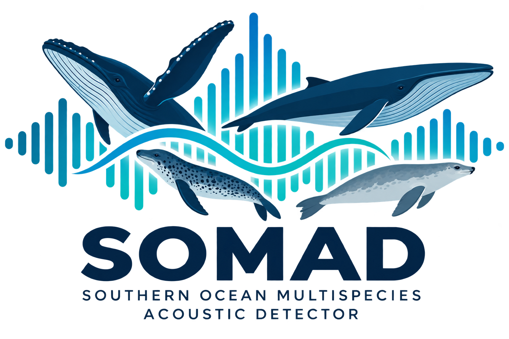

<p align="center">
  
</p>

<h1 align="center">SOMAD v19</h1>
<p align="center"><b>Southern Ocean Multispecies Acoustic Detector</b></p>

SOMAD detects 11 co-occurring Southern Ocean marine mammal call types in **one forward pass over a 60 s, 7.8 Hz–16 kHz acoustic scene**. It scores every class every 0.5 s.

- **One spectrogram for the whole band.** A variable-Q transform (VQT) is computed on the GPU as the first layer of the network: 11 octaves × 24 bins per octave, with a bandwidth offset γ = 3 Hz. It keeps hertz-level resolution for low-frequency baleen whale calls and also covers kilohertz seal and orca calls, all in the same image.
- **Joint scoring.** A CNN–BiGRU sequence tagger (93.6 M parameters) scores all classes from the same window. Classes therefore compete for the same evidence, which keeps cross-species confusion low.
- **Long context.** Each window is 60 s and is not cut around single calls, like the view an analyst scans in a spectrogram viewer.
- **Class masking.** Data sources annotated for only some of the classes can be pooled. A class a source was not annotated for, and uncertain annotations, are excluded from the loss and from the evaluation metrics.

| Class | Species | F1 | AP | Event F1 |
|---|---|---:|---:|---:|
| Fin whale 20 Hz | *Balaenoptera physalus* | 0.69 | 0.75 | 0.77 |
| Fin whale downsweep | *B. physalus* | 0.48 | 0.43 | 0.52 |
| Blue whale D call | *B. musculus intermedia* | 0.52 | 0.52 | 0.59 |
| Blue whale ABZ call | *B. musculus intermedia* | 0.71 | 0.78 | 0.77 |
| Antarctic minke whale | *B. bonaerensis* | 0.62 | 0.67 | 0.37 |
| Southern right whale | *Eubalaena australis* | 0.79 | 0.86 | 0.83 |
| Humpback whale | *Megaptera novaeangliae* | 0.80 | 0.89 | 0.52 |
| Leopard seal | *Hydrurga leptonyx* | 0.85 | 0.82 | 0.57 |
| Weddell seal | *Leptonychotes weddellii* | 0.69 | 0.71 | 0.53 |
| Crabeater seal | *Lobodon carcinophaga* | 0.71 | 0.78 | 0.81 |
| Orca | *Orcinus orca* | 0.41 | 0.34 | 0.52 |

All scores are on the held-out validation split (3,725 files) at each class's calibrated threshold. F1 and AP (average precision) are frame-level, on 0.5 s bins. The accompanying manuscript has the full method and evaluation.

## Repository layout

```
somad_v19/
├── run_inference.py          score every WAV in a folder -> one netCDF (scores, thresholds, above-threshold flags)
├── scores_to_events.py       netCDF -> event table (one row per detected call/bout, APLOSE date-time format)
├── infer_all.sh              run_inference + scores_to_events over a large dataset, in chunks, on several GPUs
├── run_v19_pipeline.sh       training pipeline: split -> overview -> train -> evaluate/calibrate thresholds
├── train_cqt.py              training entry point (called by run_v19_pipeline.sh)
├── predict_eval.py           masked evaluation and per-class threshold calibration
├── common.py                 data pipeline, VQT front end, model, losses, masking
├── class_config.json         classes, label mapping and which classes each data source was annotated for
├── class_config.py, somad_args.py, make_split.py, filter_split.py, class_data_overview.py,
│   preview_cqt_input.py, plot_confusion_matrix.py, eval_scores.py, schall_benchmark.py,
│   schall_benchmark_partial.py, fix_kerguelen2015_downsweep.py   helpers for the pipeline and manuscript analyses
├── tests_v19.py              self-tests on synthetic data (CPU)
├── split/                    train_files.txt / val_files.txt: v19's train/validation split (file names)
├── checkpoints/
│   ├── best_model.pth                    trained v19 weights (download from Zenodo, see below)
│   └── thresholds_cqt_continuous.csv     calibrated per-class decision thresholds
├── Dockerfile, requirements.txt, setup_env.sh
└── LICENSE (MIT)
```

## Installation

SOMAD is written in Python (3.9–3.13) and uses PyTorch (≥ 2.4.1). Pick one of the two options.

**Option 1: virtual environment.** `setup_env.sh` finds a suitable Python and detects the GPU, including older Pascal cards (those get a CUDA 11.8 build). It then installs PyTorch and `requirements.txt` into `.venv`.

```bash
git clone https://github.com/sebastianmenze/Southern-Ocean-Multispecies-Acoustic-Detector.git somad
cd somad
./setup_env.sh                 # add --cpu to force a CPU-only PyTorch build
source .venv/bin/activate
python tests_v19.py            # self-tests on synthetic data, ~1–2 min on CPU
```

If `import soundfile` or `import librosa` fails, install the system packages `libsndfile1` and `ffmpeg`.

**Option 2: Docker.** The image is built on PyTorch 2.9.1 with CUDA 12.8.

```bash
docker build -t somad .
docker run --gpus all --rm -v /data:/data somad run_inference.py --help
```

**Trained checkpoint.** The v19 weights (`best_model.pth`, about 1.1 GB) are archived on Zenodo, [doi:10.5281/zenodo.24530417](https://doi.org/10.5281/zenodo.24530417), and not stored in git. Download them once after cloning:

```bash
curl -L -o checkpoints/best_model.pth https://zenodo.org/records/24530417/files/best_model.pth
```

The calibrated thresholds file `checkpoints/thresholds_cqt_continuous.csv` is already in the repository.

## Worked example: detecting calls in a new deployment

This example scores a folder of recordings from a new mooring, turns the scores into call events, and summarises daily call presence per class. It is the same example as in the manuscript's Supporting Information S2. Inference also runs on CPU, but more slowly.

### 1. Score every recording

```bash
python run_inference.py \
    --checkpoint checkpoints/best_model.pth \
    --thresholds-csv checkpoints/thresholds_cqt_continuous.csv \
    --audio-dir /data/my_deployment/wav \
    --out /data/my_deployment/somad_scores.nc \
    --filename-time-format "%y%m%d%H%M%S"     # e.g. SoundTrap names 8712.250127120004.wav
```

`run_inference.py` processes every WAV file in `--audio-dir`:

- It cuts the file into 60 s windows with 50% overlap and scores each window.
- It stitches the windows back into one timeline per file, keeping the maximum score where windows overlap. Training calibrated the thresholds on the same stitched timeline.
- It loads audio at any sample rate and resamples it to SOMAD's 32 kHz.

The netCDF output has the following variables:

| Variable | Dimensions | Content |
|---|---|---|
| `scores` | file × class × 0.5 s bin | raw logits |
| `threshold` | class | calibrated threshold |
| `above_threshold` | file × class × 0.5 s bin | 0/1 detection flag |
| `start_time` | file | start time parsed from the file name |
| `duration` | file | file length |

Pass `--filename-time-format` when your file names don't follow the default `%Y_%m_%d_%H_%M_%S` pattern. For large datasets, `infer_all.sh` runs the same command in chunks over several GPUs and can be restarted where it stopped:

```bash
AUDIO_DIR=/data/my_deployment/wav NAME=my_deployment OUT=/data/somad_out GPUS="0 1" \
    INFER_ARGS="--filename-time-format %y%m%d%H%M%S" ./infer_all.sh
```

### 2. Convert scores into call events

```bash
python scores_to_events.py \
    --scores-nc /data/my_deployment/somad_scores.nc \
    --out /data/my_deployment/somad_events.csv
```

Each row is one run of consecutive above-threshold bins. The columns are:

- `source_file`
- `predicted_label`: the class
- `window_start_s`, `window_end_s`: time within the file
- `start_datetime`, `end_datetime`: absolute time, in APLOSE's format
- `confidence`: the peak sigmoid score

To try other thresholds without re-running the model, pass `--thresholds-csv` with new values.

### 3. Summarise detections in Python

```python
import matplotlib.pyplot as plt
import pandas as pd
import xarray as xr

ds = xr.open_dataset("/data/my_deployment/somad_scores.nc")

# True where a class was detected anywhere in a file (rows: files, columns: classes)
present = (ds["above_threshold"].max("bin") > 0).to_pandas()
present.index = pd.to_datetime(ds["start_time"].values)

# daily proportion of recordings with detections, per class
daily = present.sort_index().resample("D").mean()
daily.plot(subplots=True, figsize=(8, 14), sharey=True, ylim=(0, 1))
plt.tight_layout()
plt.savefig("/data/my_deployment/daily_presence.png", dpi=150)

# number of detected events per class
events = pd.read_csv("/data/my_deployment/somad_events.csv")
print(events["predicted_label"].value_counts())
```

## Training on your own data

1. **Collect the data.** Put the .wav files in `<training folder>/audio/`. Put an annotation table whose name contains `aplose` (e.g. `annotations_aplose.csv`) in `<training folder>/`. It needs one row per annotation with these columns (APLOSE result exports already have them):

   | Column | Content |
   |---|---|
   | `filename` | audio file name |
   | `start_datetime`, `end_datetime` | absolute ISO 8601 times, e.g. `2024-04-17T03:12:05.500+00:00` |
   | `annotation` | the label |
   | `type` (optional) | `WEAK` marks presence-only annotations, which are not used |

   Frequency bounds are not needed: SOMAD labels 0.5 s time bins per class. The start time of each audio file is read from its name, which must contain it as `YYYY_MM_DD_HH_MM_SS`.

2. **Configure classes and sources in `class_config.json`** (next to the scripts).
   - **Classes.** Each class maps one model output to one or more annotation labels. The model's outputs follow the order of `classes`.
   - **Uncertain labels.** Labels listed under `uncertain_labels` mask that class for the annotated time instead of counting as a positive.
   - **Sources.** `stem_source_rules` assigns files to a data source by a substring of their name. Each entry in `sources` (glob patterns allowed) sets which classes that source was annotated for in `annotated_classes`. Every other class is masked for its files, so its unannotated calls do not count as negatives. `split` is one of `random`, `train_only`, `val_only` or `ignore`. `sample_weight` scales how often the source's windows are drawn.

3. **Run the pipeline** (split, overview, train, evaluate and calibrate thresholds):

   ```bash
   TRAINING_DATA_DIR=/data/my_training_set OUTPUT_DIR=/data/somad_out ./run_v19_pipeline.sh all
   ```

   The evaluation stage writes `thresholds_cqt_continuous.csv` for the new model. Use it with `run_inference.py` as in step 1 of the worked example. You can extend the frequency range by changing the number of VQT octaves or the sample rate in `common.BAND_CONFIG["cqt"]`.

## Adding classes to the released v19 model

New classes are added by continuing training from the released checkpoint (`ADD_CLASSES_FROM`). Every layer is copied from it, and the final layer's outputs are copied by class name. The new class's output starts from random weights. The new recordings and their annotation table are prepared as in step 1 above. For example, to add Ross seal from a new data set whose file names contain `_ROSS01_`:

1. **Append the new class and source to the released `class_config.json`.** Don't start a new file. All classes of the checkpoint (the 11 reported ones plus the separate "Blue whale AB call" and "Blue whale Z call" outputs) must stay in it, in the same order, because the model's outputs follow that order.

   ```
   "classes": [ ...the 13 released classes...,
       {"name": "Ross seal", "aplose_labels": ["Ross seal"]} ],
   "uncertain_labels": { ..., "Ross seal (uncertain)": "Ross seal" },
   "stem_source_rules": [ ..., {"contains": "_ROSS01_", "source": "ross01"} ],
   "sources": { ...,
       "*soi*": {"annotated_classes": [ ...the 13 released classes... ], "split": "random"},
       "ross01": {"annotated_classes": ["Ross seal", "Leopard seal", "Weddell seal",
                                        "Crabeater seal"], "split": "random"} }
   ```

   - **The new source.** In `annotated_classes`, include every existing class the annotators also checked (here the other three seal classes). The old outputs keep learning only from such negatives.
   - **The original sources** keep their original class lists, so the new class is masked there. A source declared with `"all"` (in the released file only `*soi*`, the South Orkney recordings) would also cover the new class, so its unannotated audio would count as negatives. Ross seals can occur there, so `"all"` is replaced by the explicit list of the 13 original classes, as in the example. Keep `"all"` only where the new class cannot occur.

2. **Split only the new files and keep the released split.** `split/train_files.txt` and `split/val_files.txt` list the files of SOMAD's original training set. Keeping them ensures that no file used to validate v19 enters training. Files listed in neither list are not used.

   ```bash
   TRAINING_DATA_DIR=/data/ross01 OUTPUT_DIR=/data/ross01_out ./run_v19_pipeline.sh split
   mkdir -p /data/combined_split
   cat split/train_files.txt /data/ross01_out/split/train_files.txt > /data/combined_split/train_files.txt
   cat split/val_files.txt /data/ross01_out/split/val_files.txt > /data/combined_split/val_files.txt
   ```

3. **Train from the released checkpoint and evaluate.** `/data/all` holds the original and the new recordings and annotation tables (`audio/` and `*aplose*.csv`).

   ```bash
   ADD_CLASSES_FROM=checkpoints/best_model.pth SPLIT_DIR=/data/combined_split \
       TRAINING_DATA_DIR=/data/all OUTPUT_DIR=/data/somad_out ./run_v19_pipeline.sh train
   SPLIT_DIR=/data/combined_split TRAINING_DATA_DIR=/data/all OUTPUT_DIR=/data/somad_out \
       ./run_v19_pipeline.sh eval
   ```

   The evaluation stage writes calibrated thresholds for all classes, which are then used with `run_inference.py`.

**If only the new data are available.** Of the original training data, only the BlueFinLibrary (Miller et al., 2021) is public. Training on the new data alone with the same commands teaches the new class. But the old classes then get little or no training signal while the shared layers change, so their v19 validation results and thresholds no longer apply. Adding the public BlueFinLibrary back keeps the baleen whale classes trained.

## Reproducing the BlueFinLibrary benchmark (Schall et al., 2024)

The manuscript compares SOMAD with the detectors benchmarked by Schall et al. (2024). The comparison uses their four categories (ABZ, 20Hz20Plus, DDswp, Noise) on 15 s segments with a 2.5 s hop. A segment is labelled as a call when more than half of the call lies inside it, and segments that contain only smaller call fragments are excluded:

```bash
# 1. scores for all BlueFinLibrary site-years (run_inference.py per site-year, *.nc), then segment table + metrics
python schall_benchmark.py --scores scores_*.nc --thresholds checkpoints/thresholds_cqt_continuous.csv \
    --annotations bluefin_library_annotations.csv --out bench \
    --exclude-files split/train_files.txt --exclude-audio-dir /data/training_data/audio
# 2. 50% inclusion rule (variant "rule50"), per site-year and mean ± SD over the 11 site-years
python schall_benchmark_partial.py --segments bench/schall_segments.csv.gz \
    --annotations bluefin_library_annotations.csv --out bench/partial50
```

## Use of AI tools

The code was developed with Claude Code (Anthropic), and the authors reviewed and tested it. Every `.py` and `.sh` file carries a header line stating this.

## Licence and citation

MIT licence (see `LICENSE`). The variable-Q filter construction follows archinetai/cqt-pytorch (MIT). If you use SOMAD, please cite the accompanying article (reference to be added on publication).
